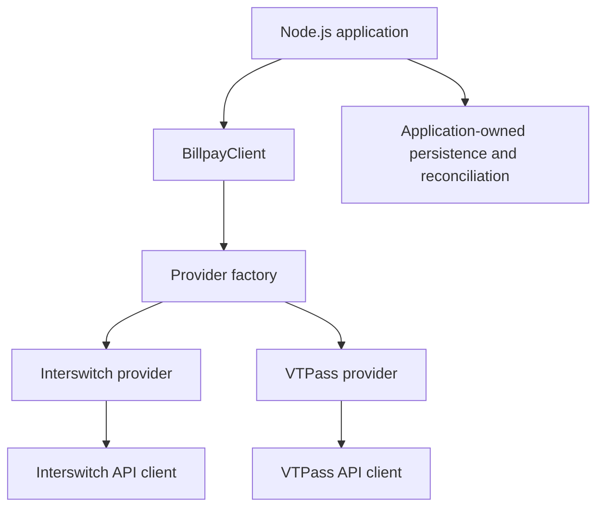

# BillPay SDK: one interface, explicit provider routing

## Problem

Interswitch and VTPass expose different interfaces for billers, validation, payments, and
transaction status. The SDK presents a TypeScript client over those integrations so an
application can work through a common interface.

## Architecture



## Decisions and tradeoffs visible in the implementation

- **The SDK is stateless.** Persistence is the application's responsibility. This avoids
  imposing an ORM or database, while requiring the caller to store references and reconcile
  transaction state.
- **Provider behavior lives behind adapters.** The factory registers configured providers
  under a common interface. Normalization simplifies callers, but cannot make every provider
  feature or failure condition identical.
- **Failover is explicit.** `pay()` selects a provider without failover. `payWithFailover()`
  uses the primary/fallback sequence, unless the request selects a provider explicitly.
  Calling applications still need a policy for ambiguous payment outcomes and reconciliation;
  a common SDK interface is not a guarantee of exactly-once payment execution.
- **Combined reads fan out.** Read operations targeting `BOTH` use `Promise.all` over the
  configured providers. This combines results, but a rejected provider request rejects that
  combined operation rather than returning a partial-success envelope.

## Read the implementation

- [Client and routing behavior](../src/clients/BillpayClient.ts)
- [Provider interface](../src/common/interfaces/bill-payment-provider.ts)
- [Provider factory](../src/providers/factory.ts)
- [Client tests](../tests/BillpayClient.test.ts)
- [Import-surface tests](../tests/imports.test.ts)

## Minimal configuration example

```ts
import { BillpayClient } from 'billpay';

const client = new BillpayClient({
  vtpass: {
    apiKey: process.env.VTPASS_API_KEY!,
    secretKey: process.env.VTPASS_SECRET_KEY!,
    publicKey: process.env.VTPASS_PUBLIC_KEY!,
    apiBaseUrl: 'https://sandbox.vtpass.com/api',
    phone: '08011111111',
  },
});

console.log(client.getActiveProviders());
```

This example configures a client and inspects routing; it does not submit a payment. See the
[README](../README.md) for validated-customer and payment examples. Keep provider credentials
in your environment and use the sandbox for integration development.

## Status

The SDK is published as [`billpay` on npm](https://www.npmjs.com/package/billpay), separately
from the [BillPay application](https://github.com/deveasyclick/billpay). These notes explain
source behavior; they do not claim measured transaction success, adoption, or latency.
